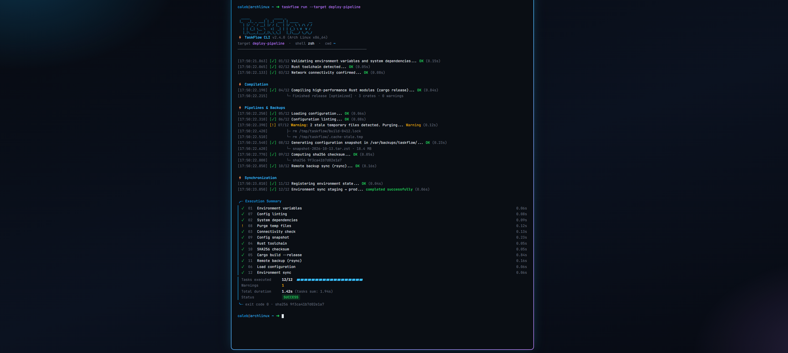
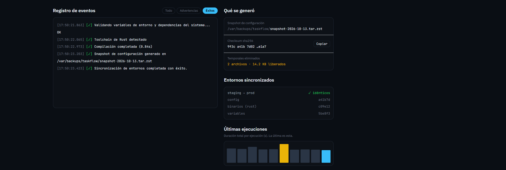
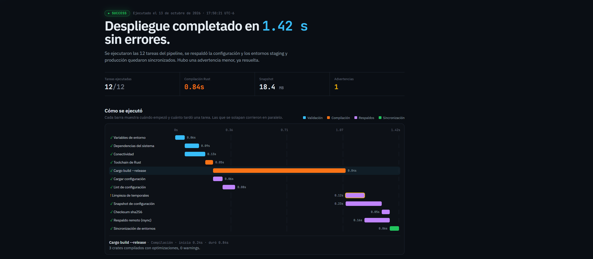

# ⚡ TaskFlow CLI (Case Study)

> **🔒 Nota de confidencialidad:** El código fuente de esta herramienta es de carácter privado y propietario. Este repositorio documenta únicamente la arquitectura, el diseño de la interfaz de consola, las métricas de ejecución y el caso de uso.

---

## 🎯 Descripción General
**TaskFlow CLI** es una utilidad de línea de comandos diseñada para acelerar y estandarizar tareas técnicas repetitivas. Permite a desarrolladores y administradores de sistemas ejecutar rutinas de automatización, gestión de respaldos, compilación y preparación de entornos sin intervención manual propensa a errores.

---

## 🖥️ Interfaz e Inspección de Ejecución

### 1. Consola de Comandos (Terminal CLI)
Muestra la ejecución directa de la herramienta en **Arch Linux**, destacando la velocidad de compilación en **Rust** (`cargo release`), la sincronización de archivos y el desglose de métricas con tiempos por paso.

  

---

### 2. Dashboard de Reportes y Mantenimiento
Vista explicativa del panel de control de eventos, mostrando el estado de sincronización de entornos (`staging -> prod`), la verificación de integridad mediante suma de comprobación SHA-256 y el histórico de ejecuciones.

  

---

### 3. Reporte de Despliegues y Métrica Temporal
Análisis gráfico del pipeline completado en **1.42s sin errores**, desglosando la duración por etapas (variables de entorno, conectividad, build en Rust, respaldos y sincronización).

  

---

## 🛠️ Stack Tecnológico

  

- **Lenguajes:** Python, Bash, Rust, Node.js
- **Entorno:** CLI (Command Line Interface), Linux / POSIX Shells
- **Automatización:** Pipelines de scripting y gestión de procesos del sistema

---

## 🚀 Características Principales

### 1. Automatización de Flujos (Workflows)
- Ejecución secuencial y en paralelo de tareas de preparación de proyectos.
- Normalización de entornos y scripts reutilizables.

### 2. Sincronización y Mantenimiento
- Respaldos automatizados de archivos de configuración e índices.
- Verificación de integridad y limpieza de temporales.

